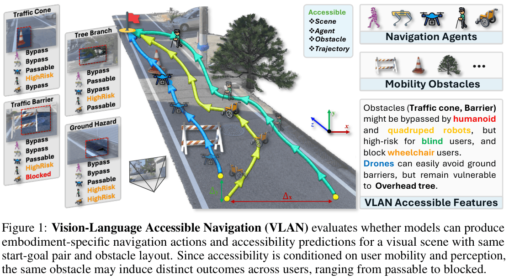
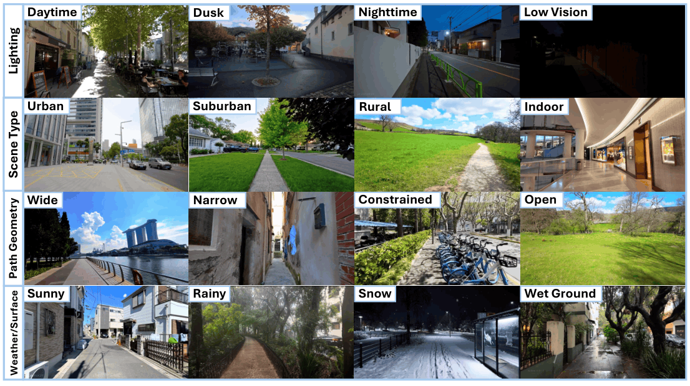

# VLAN: Vision-Language Accessible Navigation

<p align="center">
<a href="https://huggingface.co/datasets/InSAI-Lab/VLAN">
    </a>
<a href="LICENSE">
    </a>
</p>



VLAN is a user-conditioned navigation benchmark and evaluation toolkit for multimodal models.

## Updates

- [ ] [TBD], Release of a fine-tuned compact baseline model.
- [ ] [TBD], Training split and fine-tuning pipeline release.
- [x] [06/2026], Evaluation toolkit and benchmark code released.
- [x] [06/2026], Dataset released on [Hugging Face](https://huggingface.co/datasets/InSAI-Lab/VLAN).

## Highlights

|                                      |                                                              |
| ------------------------------------ | ------------------------------------------------------------ |
| **Five embodiments, one scene**      | Humanoid, quadruped robot, drone, BVI user, and wheelchair user are evaluated on identical geometry and obstacle layouts. |
| **Accessibility-conditioned labels** | Every trajectory carries a user-specific label from {Passable, Bypass, HighRisk, Blocked}. |
| **Two task families**                | Low-level action prediction for embodied agents; high-level language guidance for human users. |
| **Benchmark-aligned metrics**        | Goal-reaching, collision-aware, and accessibility-aligned scores, with a balanced cross-user aggregate (AccSR). |
| **Real-to-interactive pipeline**     | Egocentric videos → Gaussian Splatting → Unity editing → trajectory generation → keyframe rendering. |

## Supported Users and Tasks

The codebase supports two task families:

**Action Prediction Navigation**

- `drone`
- `quadrupedRobot`

**Language-Guided Navigation**

- `humanoid`
- `blind`
- `wheelchair`

Notes on task naming:

- `humanoid` is the public task name; `pedestrian` is retained as a legacy alias.
- `blind` is the public task name; older `bvi` fields are mapped internally.

The public release supports the reorganized dataset layout used in the benchmark release, while
retaining compatibility with the older internal layout.

The codebase supports two task families:

- Action Prediction Navigation
  - `drone`
  - `quadrupedRobot`
- Language-Guided Navigation
  - `humanoid`
  - `blind`
  - `wheelchair`

## Installation

Python 3.10 or newer is required.

```bash
git clone https://github.com/InSAI-Lab/VLAN.git
cd VLAN
python -m venv .venv
source .venv/bin/activate
pip install -r requirements.txt
```

A CUDA-capable GPU is required to run inference with local checkpoints.

## Dataset

### Overview


### Download

The dataset is hosted on [Hugging Face](https://huggingface.co/datasets/InSAI-Lab/VLAN)

```bash
# Option 1: huggingface_hub CLI
pip install -U huggingface_hub
hf download InSAI-Lab/VLAN --repo-type dataset --local-dir ./data

# Option 2: git with LFS
git lfs install
git clone https://huggingface.co/datasets/InSAI-Lab/VLAN ./data
```

The release provides the test split as ten compressed shards plus a small sample set:

```text
data/
  vlan/                     # 10 shards, ~19 GB total
    vlan_part01.tar.zst
    ...
    vlan_part10.tar.zst
  samples/
    samples.tar.zst         # small browsable subset
```

Extract the shards into a single directory:

```bash
cd data
mkdir -p test
for f in vlan/vlan_part*.tar.zst; do tar -I zstd -xf "$f" -C test; done
```

## Quick Start

### Build Targets and Contexts

```bash
python tools/build_targets.py --data_root /path/to/test --artifacts_root artifacts
python tools/build_contexts.py --data_root /path/to/test --artifacts_root artifacts
```

### Run Inference

```bash
python tools/run_inference.py \
  --config configs/runs/default.yaml \
  --task humanoid \
  --model-config configs/models/qwen2_5_vl_3b_instruct.yaml \
  --data-root /path/to/test \
  --artifacts-root artifacts
```

The legacy alias `pedestrian` is also accepted for `--task`.

### Run Evaluation

```bash
python tools/evaluate.py \
  --config configs/runs/default.yaml \
  --task humanoid \
  --model-config configs/models/qwen2_5_vl_3b_instruct.yaml \
  --data-root /path/to/test \
  --artifacts-root artifacts
```

Action-prediction tasks use the same entry point with `--task drone` or `--task quadrupedRobot`.
Predicted action sequences take the form:

```json
[{"dx": ..., "dz": ..., "yaw": ...}, ...]
```

## Model Checkpoints

Model configuration files in `configs/models/` assume checkpoints are available under a local
`ckpts/` directory:

```text
ckpts/Qwen2.5-VL-3B-Instruct
ckpts/Qwen2.5-VL-7B-Instruct
ckpts/Qwen3-VL-8B-Instruct
ckpts/InternVL3.5-8B
ckpts/Idefics3-8B-Llama3
ckpts/Molmo2-8B
ckpts/Llama-3.2-11B-Vision-Instruct
```

## References
We would like to express our gratitude to the authors of the open-source projects
on which this work is built. In particular, we thank the [Vid2Sim](https://huggingface.co/datasets/insailab/VLAN) team for releasing
their code and models, which greatly facilitated our research.

## License

This repository is under the MIT license.
